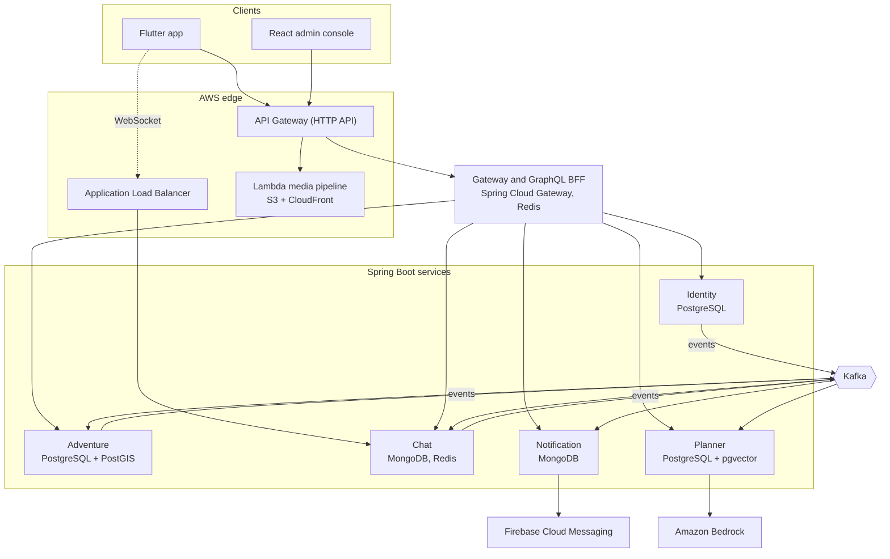

# Triplor: architecture and roadmap

Triplor is a travel-matching app. Travellers post an adventure (destination, dates, style, group size), others discover it and ask to join, and accepted travellers plan the trip together in chat.

This document records where the project stands, the target system, and the order it will be built in.

**Status (2026-11-10):** proposal. Only the Flutter client described under "Starting point" exists. Update the table as work lands.

| Phase | Scope | Status |
|---|---|---|
| 1 | Core backend: identity, adventure and chat services ([detailed plan](plans/phase-1.md)) | Not started |
| 2 | Kafka, Redis, notification service, gateway ([detailed plan](plans/phase-2.md)) | Not started |
| 3 | Flutter integration, React admin, GraphQL, RAG planner | Not started |
| 4 | CI/CD and AWS deployment | Not started |

## Starting point: the Flutter client

The client is 2,562 lines of Dart in 29 files. It implements one feature, adventure CRUD, against an in-memory list.

| Area | State | What's there |
|---|---|---|
| Navigation | Done | GoRouter `ShellRoute`, four-tab bottom nav, seven routes |
| Adventure CRUD | Done, local only | List, details, delete with confirm, and one screen shared by create and edit |
| State management | Done | Riverpod 3: `FutureProvider` (and `.family`) for reads; four `Notifier`s for create, update, delete and form state |
| Data layer | Fake | `AdventureRepository` is a `List` with `Future.delayed` latency; IDs come from `millisecondsSinceEpoch` |
| Models | Partial | `Adventure`, `LocationModel`, `DateRangeModel` are used. `UserProfileModel`, `MatchRequestModel`, `ChatMessageModel` are declared but no screen uses them. No JSON serialization |
| Requests, Chats, Profile | Stub | Each screen is one placeholder `Text` |
| Auth | Missing | `userId` is the literal `"temp"` |
| Networking, persistence | Missing | Dependencies are `flutter_riverpod`, `go_router` and `intl` only |
| Tests | Thin | Seven cases in three files; nothing covers the notifiers |

The details screen hard-codes the organizer name, rating and trip count, the member avatars, the "Open for Joining" badge and the hero image. The home card hard-codes "5 Interested", and every saved location gets `country: "Default"`. Home lists only the user's own adventures, so there is no discovery feed and nothing to match against yet.

### Known issues to fix during backend integration

1. **Stale success state.** `copyWith` in `mobile/lib/features/home/providers/create_adventure_state.dart:24` (and the update equivalent) uses `value ?? this.value`, so a previous `createdAdventure` survives into the next attempt, and the provider is never disposed. After one successful create, a later failed create still shows the success message, because `mobile/lib/features/home/presentation/create_adventure_screen.dart:298` checks that field first. It cannot happen today only because the in-memory repository never fails.
2. **Edit-mode loading and error screens never render.** The result of `adventureAsync.when(...)` at `mobile/lib/features/home/presentation/create_adventure_screen.dart:91` is discarded, so a failed load shows an empty form.
3. **Release builds have no network access.** The `INTERNET` permission exists only in the debug and profile Android manifests.
4. **Model gaps.** `MatchRequestModel` has no `adventureId` and `ChatMessageModel` has no `conversationId`, so neither can be tied to a trip or a thread.

One thing is already right: screens reach data only through `adventureRepositoryProvider`, and the widget test already overrides providers, so swapping in an HTTP repository will not touch the UI.

## Target architecture



### Service boundaries

A service exists only where the storage model, scaling profile or failure domain differs. Adventures and join requests share one service because accepting a request and taking a seat must be a single database transaction; splitting them would create a distributed transaction for no gain.

| Service | Owns | Store |
|---|---|---|
| gateway | Routing, JWT validation, rate limits, GraphQL read aggregation | Redis |
| identity | Accounts, tokens, profiles, verification | PostgreSQL |
| adventure | Trips, discovery search, join requests, seats, membership | PostgreSQL + PostGIS |
| chat | Conversations, messages, read state, presence, WebSocket delivery | MongoDB, Redis |
| notification | Push and in-app inbox, driven by events | MongoDB |
| planner | Destination knowledge base, plan drafts, similarity ranking | PostgreSQL + pgvector |

Services do not call each other in the write path. They exchange events through Kafka; only the gateway fans out synchronous reads, behind circuit breakers.

### Why each technology is here

Every technology is tied to a product feature. If the feature goes away, so does the technology.

#### Data and messaging

| Technology | Triplor feature that needs it | Why not the alternative |
|---|---|---|
| PostgreSQL + PostGIS | Discovery ("trips within 50 km of Goa overlapping 10–17 Dec, style Hiking") is `ST_DWithin` plus a `daterange` overlap on GiST indexes; seats and request states need transactions | Elasticsearch adds nothing until relevance-ranked text search is needed |
| MongoDB | Chat messages: append-heavy, read by conversation in time order, varied payloads, no joins. Also the notification inbox, expired by a TTL index | Postgres would cope at this size; the access pattern is the reason. At very large scale this would move to a wide-column store such as Cassandra |
| Kafka | Adventure events feed three independent consumers (chat membership, notifications, planner re-embedding), need per-adventure ordering, and must be replayable to rebuild a projection or re-embed after a model change | RabbitMQ deletes on ack and is best at routed task queues with priorities and delays, which Triplor does not have |
| Redis | Gateway token buckets; cache-aside for trip details and search pages; pub/sub so a chat message reaches sockets held by other instances; presence keys with a TTL | Not the durable queue: pub/sub is fire-and-forget, acceptable only because messages are saved first and clients resync |
| pgvector | Embeddings for the planner's knowledge base, filtered by destination in the same SQL query | A separate vector database is unjustified below millions of chunks |

#### Distributed-systems patterns

| Pattern | Where it is needed | Design note |
|---|---|---|
| Idempotency keys | Create adventure and send request: phones retry on bad networks and users double-tap. Accept, reject and withdraw need no key, because the request's state machine already makes them idempotent | Stored in Postgres in the same transaction as the write, so key and effect commit together |
| Conditional update | The last seat: `UPDATE adventures SET seats_taken = seats_taken + 1 WHERE id = ? AND seats_taken < capacity` | Deliberately not a Redis lock. A lock that expires during a pause can oversell; the database is the source of truth |
| Distributed lock | ShedLock, so "expire requests pending for 72 hours" runs on one instance; a Redis single-flight lock per adventure, so a double-tap does not pay for two LLM generations | Locks guard work that must not be duplicated, not data invariants |
| Transactional outbox | The request row and its event are written in one transaction; a relay publishes to Kafka | Removes the failure where the database commits and the publish is lost. Only one relay is active at a time, which keeps each adventure's events in order |
| Idempotent consumers, retry topics, dead-letter topic | Every Kafka consumer; push delivery through FCM | Kafka delivers at least once, so each consumer dedupes on `eventId` |
| Circuit breaker | Calls to Bedrock and FCM, and gateway fan-out to services | The planner falls back to showing retrieved guide excerpts when the model is unavailable |
| Rate limiting | Join-request spam, login brute force, LLM cost per user per day | Token bucket in Redis via a Lua script, so check-and-decrement is atomic |

#### Clients, API and cloud

| Technology | Why Triplor needs it |
|---|---|
| WebSocket (STOMP) | Chat needs server push; polling wastes battery and adds delay |
| GraphQL, reads only | The trip-details screen needs the adventure, organizer, first members, interested count and the viewer's request status from three services, and the admin console needs other shapes of the same data. Writes stay REST, where idempotency keys and status codes are simpler |
| React admin console | The app tells users trip details are "visible only to verified users", so someone must verify IDs and act on reports. It also hosts the funnel dashboard and dead-letter replay |
| RAG | "Draft my plan" in the create flow, grounded in Wikivoyage. Without retrieval the model invents venues; with it every suggestion cites a source and retrieval quality can be measured |
| ECS Fargate | Long-lived JVM services, Kafka consumers and WebSockets |
| Lambda | The image pipeline: issue a pre-signed upload URL, then thumbnail on the S3 event. Short, spiky, stateless work that should scale to zero |
| API Gateway | Public edge: throttling, JWT check, `/media` to Lambda, everything else to the Spring gateway |
| EC2 | A single-node Kafka broker, because managed Kafka is priced for production. Production would be MSK with three brokers and replication factor 3 |
| RDS | One Postgres instance holding three databases (identity, adventure, planner) with separate credentials; separate instances in production |
| Kubernetes | Optional: the same images deployed with Helm to a local kind cluster, without paying for an EKS control plane |

### Key flow: accepting a join request

Most of the patterns above meet in this one path.

1. The app sends `POST /join-requests/{id}/accept`; the gateway checks the JWT and the caller's token bucket.
2. The adventure service, in one Postgres transaction, takes a seat with the conditional update, moves the request from `PENDING` to `ACCEPTED` only if it is still pending, and inserts a `JoinRequestAccepted` row into `outbox`. If no seat is left, nothing is written and the caller gets a 409. Retrying an already accepted request changes nothing and returns 200.
3. A single active relay, guarded by a Postgres advisory lock, reads the outbox in insert order and publishes to Kafka, keyed by `adventureId`.
4. Chat adds the traveller to the trip's conversation and Notification pushes to them. Both dedupe on `eventId`, so redelivery is harmless.
5. If FCM is down, the message moves to a retry topic and then a dead-letter topic the admin console can replay. The accept itself has already succeeded.

### Left out on purpose

- **RabbitMQ:** there are no routed, prioritised or delayed task queues. The one delayed job (expiring stale requests) is a scheduled task.
- **Elasticsearch:** PostGIS, GiST indexes and Postgres full-text search cover discovery.
- **A dedicated vector database:** pgvector is enough at this corpus size.
- **Eureka and Config Server:** Cloud Map and Kubernetes DNS already do discovery.
- **A schema registry:** one repo with a shared event module gives compile-time contracts.
- **A saga orchestrator:** the only cross-service workflow has three steps, so choreography is enough.
- **EKS hosting:** the control plane is a fixed cost; ECS hosts the demo and kind covers Kubernetes.

## Roadmap

The repo is a monorepo, with the Flutter app in `mobile/`:

```
triplor/
├── mobile/        existing Flutter app
├── services/      identity · adventure · chat · notification · planner · gateway
├── libs/common/   event envelope, error model, security config
├── web-admin/     React + TypeScript
├── lambdas/       media-presign · media-processor
└── infra/         compose · terraform · k8s
```

Phases 1 and 2 form a complete, deployable backend. Phases 3 and 4 are additive.

The summaries below are the overview. Milestone-by-milestone plans with schemas, algorithms and test lists are in [plans/phase-1.md](plans/phase-1.md) and [plans/phase-2.md](plans/phase-2.md).

### Phase 1: Core backend, synchronous on purpose

Build the identity, adventure and chat services (chat is REST-only for now).

| Store | Table or collection | Key fields and constraints |
|---|---|---|
| identity (Postgres) | `users` | `email` unique, `password_hash`, `role`, `status` |
| | `profiles` | `display_name`, `date_of_birth`, `bio`, `avatar_media_id`, `styles[]`, `verified_at` |
| | `refresh_tokens` | `token_hash`, `family_id`, `expires_at`, `revoked_at` (rotation with reuse detection) |
| | `verification_requests` | `user_id`, `document_media_id`, `status`, `reviewed_by` |
| adventure (Postgres) | `places` | GeoNames cities: `name`, `country_code`, `location`; trigram index for autocomplete |
| | `adventures` | `organizer_id`, `place_id`, `lat`, `lng`, `start_date`, `end_date`, `styles text[]`, `capacity`, `seats_taken`, `status`, `version`; generated columns `location geography` and `trip_dates daterange` with GiST indexes; GIN on styles; a check that `seats_taken` never exceeds `capacity` |
| | `join_requests` | `adventure_id`, `requester_id`, `message`, `status`, `expires_at`; partial unique index on (adventure, requester) while pending or accepted |
| | `adventure_members` | `adventure_id`, `user_id`, `role` |
| | `idempotency_keys` | `user_id`, `key`, `request_hash`, stored response; unique on (user, key) |
| chat (MongoDB) | `conversations` | `adventureId`, `memberIds[]`, `lastMessageAt`; index on `{memberIds, lastMessageAt}` |
| | `messages` | `conversationId`, `senderId`, `clientMessageId`, `type`, `body`; index on `{conversationId, _id}`; `clientMessageId` unique per sender |
| | `read_states` | `conversationId`, `userId`, `lastReadMessageId` |

| Service | Endpoints |
|---|---|
| identity | `POST /auth/register`, `/auth/login`, `/auth/refresh`, `/auth/logout` · `GET /.well-known/jwks.json` · `GET`, `PATCH /users/me` · `GET /users/{id}` · `GET /users?ids=` · `POST /users/me/verification` · `GET /admin/verifications` · `POST /admin/verifications/{id}/approve` · `POST /admin/verifications/{id}/reject` |
| adventure | `POST /adventures`* · `GET`, `PATCH`, `DELETE /adventures/{id}` · `GET /adventures/mine` · `GET /adventures/search?lat&lng&radiusKm&from&to&styles&cursor` · `GET /adventures/{id}/matches` · `GET /places?q=` · `POST /adventures/{id}/join-requests`* · `GET /join-requests?direction=&status=` · `POST /join-requests/{id}/accept` · `POST /join-requests/{id}/reject` · `DELETE /join-requests/{id}` · `GET /adventures/{id}/members` |
| chat | `GET /conversations` · `GET /conversations/{id}/messages?before=&limit=` · `POST /conversations/{id}/messages` · `PUT /conversations/{id}/read` · internal `PUT /internal/conversations/{adventureId}/members` |

`*` requires an `Idempotency-Key` header. Accept, reject and withdraw are idempotent without one. `PATCH` takes `If-Match` with the row version, which fixes lost updates in the edit flow.

- **Tests:** JUnit 5 and Mockito on the request state machine and seat rules, `@WebMvcTest` slices, and Testcontainers (PostGIS, MongoDB) integration tests. Two of them are the evidence for the seat and idempotency guarantees: 50 concurrent accepts on a five-seat trip where exactly five succeed, and a replayed `Idempotency-Key` that yields one row and the same response.
- **Packaging:** Flyway migrations, OpenAPI via springdoc, multi-stage Dockerfiles, one `docker compose up`. A GitHub Actions test workflow starts here; deployment waits for Phase 4.
- **Deliberate shortcut:** accept calls chat synchronously over HTTP. Leave it and record a k6 baseline. It is the "before" measurement for Phase 2 and shows the coupling that events remove.
- **Done when:** a scripted flow passes against compose: register two users, create a trip, find it by search, request, accept, and both see the conversation.

### Phase 2: Messaging, Redis and distributed patterns

Add Kafka (single node, KRaft), Redis, the notification service and the gateway.

- **Outbox and topics:** outbox plus relay in identity and adventure. `adventure.events` carries all adventure, request and membership events keyed by `adventureId` so they stay ordered; also `user.events` and `chat.events`.
- **Async accept:** replace the synchronous call to chat with a consumer. Chat keeps its own copy of membership, so sending a message never calls another service.
- **Real-time chat:** STOMP over WebSocket at `/ws` for delivery (`SUBSCRIBE /topic/conversations/{id}`) and typing indicators; sending stays on REST, so there is one write path. Redis pub/sub fan-out, presence keys.
- **Notification service:** consumers with retry topics and a dead-letter topic, FCM behind a circuit breaker, in-app inbox.
- **Gateway:** Spring Cloud Gateway with JWT validation, Redis token buckets per user and per IP, timeouts and circuit breakers.
- **Adventure service:** cache-aside (details evicted on write; first search pages keyed by geohash cell, radius bucket, dates and styles, with a 60-second TTL), a cap of 20 join requests per user per day, and a ShedLock job that expires stale requests.
- **Observability:** OpenTelemetry metrics, traces and logs exported to one Grafana container, with trace context carried through the outbox and Kafka headers.

| Store | New table or collection | Purpose |
|---|---|---|
| identity, adventure | `outbox` | Events written in the same transaction as the change |
| adventure | `processed_events`, `shedlock`, `user_snapshots` | Consumer dedupe; scheduler lock; verified and suspended flags fed from `user.events`, so "verified users only" needs no synchronous call |
| notification (MongoDB) | `notifications`, `devices`, `user_names`, `dead_letters` | Inbox with a 90-day TTL index; push tokens; display names fed from `user.events`; failed events kept for replay |

New endpoints: `GET /notifications`, `PUT /notifications/{id}/read`, `PUT /devices/{token}`, `GET /admin/dead-letters`, `POST /admin/dead-letters/{id}/replay`, `POST /admin/users/{id}/suspend`.

- **Tests:** Testcontainers Kafka and Redis. The same event delivered twice produces one notification; killing the relay mid-batch loses nothing; with notification stopped, accept still returns 200 and events drain on restart; exceeding the bucket returns 429.
- **Done when:** a second k6 run gives the before-and-after accept latency, and stopping the notification service does not break accept.

### Phase 3: Clients and differentiators

- **Flutter:**
  - Networking: `dio` with interceptors for the bearer token, refresh on 401 and a UUID `Idempotency-Key`; secure token storage; JSON models; an `ApiAdventureRepository` behind the existing provider.
  - Screens: login and register with a router guard; Discover split from My Adventures; Requests, Chats and Profile built out; place autocomplete replacing `country: "Default"`.
  - Fixes: the four known issues listed under "Starting point".
- **GraphQL on the gateway** (Spring for GraphQL, queries only): `adventure(id)`, `discover(filter, after)`, `me`, plus admin `verificationQueue`, `reports` and `funnel(range)`. DataLoader batches organizer lookups into one `GET /users?ids=`. Add a depth limit.
- **React admin** (React, TypeScript, Vite), gated on an admin role claim: verification queue, reports and takedowns, funnel dashboard, dead-letter replay.
  - New endpoints: `POST /reports`, `GET /admin/reports`, `POST /admin/adventures/{id}/takedown`, `GET /admin/metrics/funnel`. The verification and suspension endpoints already exist from Phases 1 and 2.
- **Planner service (RAG):**
  - Ingest: Wikivoyage dump, split by section (See, Do, Eat, Stay safe), embedded with a Bedrock embedding model into `kb_chunks`.
  - Retrieve: filter by destination, then fuse vector and full-text results and keep the top eight. Proper nouns like beach names match better lexically, which is why it is hybrid.
  - Generate: Claude through the official Anthropic Java SDK (`com.anthropic:anthropic-java`) using its Bedrock backend. Use `claude-opus-5-5` (`anthropic.claude-opus-5-5` on Bedrock). The model ID is configuration, so the cost and quality trade-off can change without a code change.
  - Grounding: `/plan` returns a structured itinerary where every activity lists `sourceChunkIds`, validated server-side against what was retrieved. `/ask` uses the API's citations feature instead, since citations and structured output cannot be combined in one request.
  - Guards: per-user daily quota, single-flight lock, and a circuit breaker with the excerpt fallback. Treat a `refusal` or `max_tokens` stop reason as a failure rather than reading the content.
  - Match suggestions: the adventure service filters candidates by geography, date overlap and shared styles. The planner re-ranks them by description similarity, using embeddings refreshed from `adventure.events`. The gateway merges the two and falls back to the unranked list when the planner's breaker is open.
  - Evaluation: a golden set of questions across destinations, scored by hit-rate@5 for vector-only and hybrid retrieval.
  - Tables: `kb_destinations`, `kb_chunks` (content, `embedding vector`, `tsv tsvector`; HNSW and GIN indexes), `adventure_embeddings`, `ai_usage`.
  - Endpoints: `POST /ai/adventures/{id}/plan` (streamed), `POST /ai/adventures/{id}/ask`, `POST /ai/similar`, and `PUT /adventures/{id}/plan` on the adventure service to save an accepted draft.
- **Media:** `POST /media/upload-urls`, backed by MinIO locally.
- **Done when:** the Flutter app completes the full loop against compose, an admin can verify a user, a plan draft shows its sources, and the eval script prints a hit rate.

### Phase 4: Cloud and DevOps

- **GitHub Actions, on pull request:** path-filtered build per service, unit and Testcontainers tests, coverage gate, `flutter analyze` and `flutter test`, React build.
- **GitHub Actions, on main:** image build to ECR tagged by commit SHA, image scan, Flyway migration task, rolling ECS deploy, smoke test. AWS access is through an OIDC role, with no stored keys.
- **Edge:** API Gateway (HTTP API) reaches the gateway tasks through a VPC Link and Cloud Map, and sends `/media/*` to Lambda. Its JWT authorizer uses the JWKS and OIDC discovery document that identity publishes. An ALB carries `wss://` to chat, because HTTP APIs cannot proxy WebSockets to containers.
- **Compute and data:** six Fargate services; RDS Postgres with PostGIS and pgvector; Kafka (and Redis, or ElastiCache) on EC2; MongoDB Atlas free tier in an AWS region; S3 and CloudFront for media and the React build.
- **Networking:** Fargate tasks get public IPs and security groups that admit only the VPC link and ALB, which avoids a NAT gateway. The data stores accept connections only from the service security group. Production would use private subnets with NAT or VPC endpoints.
- **Access and secrets:** Bedrock is reached through the ECS task role, so no API key lives in a container (check the model is enabled in the chosen region). Other secrets go in Secrets Manager.
- **Infrastructure as code:** everything in Terraform, so the stack can be brought up for a demo and destroyed afterwards. This has not been priced. The design avoids the three items that usually dominate a small AWS bill (managed Kafka, NAT gateways, an EKS control plane), but check the AWS pricing calculator before leaving anything running.
- **Kubernetes, optional:** a Helm chart for the same images on a local kind cluster, with probes from Spring Actuator and an autoscaler on the gateway.
- **Done when:** a merge to main deploys, k6 against AWS gives the final numbers, and teardown is verified.

## Measurements

No performance or quality number is claimed until it has been measured this way.

| Number | Where it comes from |
|---|---|
| p95 latency and requests per second | k6 run summary, first against compose, then against AWS |
| Zero oversold seats, zero duplicate writes | The two Testcontainers tests from Phase 1 |
| Before-and-after accept latency | The same k6 scenario at the end of Phase 1 and Phase 2, run with chat healthy and with chat slowed by 500 ms |
| Cache hit ratio | Micrometer counters in Grafana during the k6 run |
| Retrieval hit-rate@5 | The planner eval script, run for vector-only and hybrid |
| Test count and coverage | JaCoCo report and the GitHub Actions run |

## Prerequisites

- An LTS JDK, 21 or newer
- Docker, required by Testcontainers and compose
- The Flutter SDK for `mobile/`
- The Maven or Gradle wrapper checked into the repo, so no global build tool is needed
